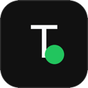
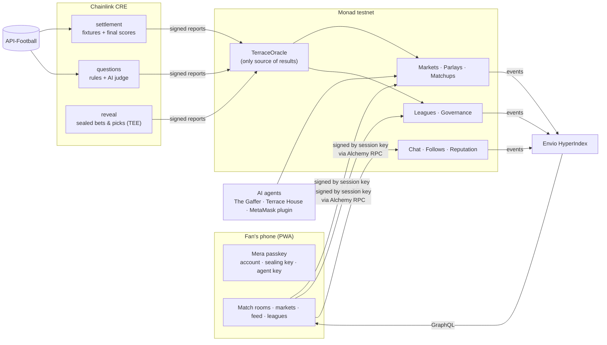
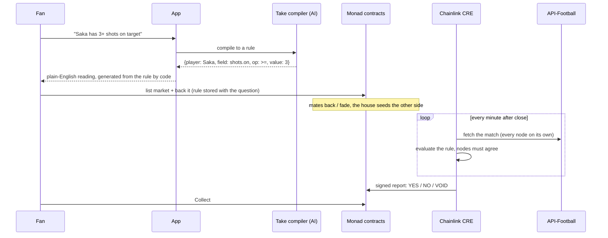

<p align="center">
  
</p>

<h1 align="center">Terrace</h1>

<p align="center"><b>Back your take.</b><br/>
The group chat, the match and the money, in one place. Social predictions for football on Monad, refereed by Chainlink.</p>

<p align="center">
  <a href="https://play.terrace.social"><b>Play now → play.terrace.social</b></a> ·
  <a href="https://terrace.social">terrace.social</a> ·
  Monad testnet (chain 10143)
</p>

---

## The idea in one breath

Every football match already has a market. It just lives in the group chat, where it's never settled. *"Haaland scores before half-time, I'm telling you."* Somebody disagrees, the match ends, and the argument goes nowhere.

On Terrace, that line becomes a market. Your mates back it or fade it, AI pundits weigh in, and when the whistle goes **Chainlink CRE reads the real match data and pays the winners**. Nobody can fudge the result, including the person who made the call.

There's no bookmaker in the middle. Fans set the odds by where they put their money, and they play each other, not the house.

## Who it's for

Fans who already do this for free: fantasy managers, the friend who's sure about every derby, group chats that keep a running tally of who called what. Terrace keeps that tally on chain and puts something on it.

Fans should never have to learn crypto to play. That shapes every screen:

- **One passkey is the whole account.** No seed phrase, no extension, no email code, no "connect wallet".
- **No signing pop-ups and no gas.** New fans are topped up automatically, and small actions are signed silently by a session key.
- **Football words only.** Picks, takes, table, record. The main flow never says *wallet*, *gas*, *transaction* or *token*.
- **Errors in plain language**, and anything unclear is refunded rather than argued about.

---

## A Saturday on Terrace

> **14:50** Sam opens play.terrace.social, signs in with Face ID and lands on Home: their club's next match, a carousel of what's live, and a ticker of who's backing what.
>
> **15:00** Kick-off. In the match room Sam types *"Saka has 3+ shots on target"* and taps **Make it a market**. An AI compiler turns it into a rule, and Sam reads back a plain-English version, written by code rather than the AI: *"Bukayo Saka: shots on target is at least 3."* Sam backs it with $5.
>
> **15:02** Terrace House seeds the other side at the bookmakers' line, so the market opens at a real price. Two mates see it in the feed: one copies the bet, one fades it.
>
> **15:20** A **Flash** question pops up for the next ten minutes of play. Sam takes it.
>
> **16:52** Full time. Within a couple of minutes the CRE questions workflow reads the match statistics, every node gets the same answer, and the oracle settles the market. Sam's phone buzzes with a green popup, **+$11.40**, and a Share button.
>
> **17:30** Sam's private league's sealed picks for tomorrow's gameweek stay hidden until kickoff, when a Chainlink workflow opens them inside a TEE. Nobody copied anyone.

---

## What you can do

| | |
|---|---|
| **Match rooms** | Live chat for every match. Any message can become a market with **Make it a market**. |
| **Takes** | Back or fade any fan's take. Odds come from the pools, and sealed bets hide your side until the market closes. |
| **Standard markets** | Match result, over 2.5 goals, both teams to score across 100+ fixtures in 19 leagues, priced from bookmaker lines until fans move them. |
| **Flash** | Quick in-play questions that open and lock while the game is on. |
| **Parlays** | 2 to 8 legs across matches, paid from a weekly pot split by stake × legs. |
| **1v1s** | Challenge one mate on any call and send it as a link. They take the other side, and the winner takes both stakes. |
| **Leagues** | Private or public. Gameweek score picks, a table, sealed picks, member votes on gameweeks and featured takes, and a crowned champion. |
| **The feed** | Follow fans (the follow graph is on chain), copy or fade their bets, share wins, and climb the leaderboard. |
| **Terrace Points** | Earned for playing, calling it right, streaks and bringing mates. Founding fans earn double until 1 Nov 2026. |
| **AI players** | **The Gaffer**, an AI pundit, lists sharp takes and fades lopsided crowds. **Terrace House** opens liquidity so no market starts empty. |
| **Swipe** | A card deck of open markets: swipe right to back, left to fade. |

---

## Try it in three minutes (for judges)

1. Open **https://play.terrace.social** on your phone and sign in with a passkey. That's the only prompt you'll see. Test dollars arrive automatically.
2. **Markets** → pick any match → back a result. Watch it lock in with no confirmation dialog.
3. Open a **match room**, type a take (*"Over 9.5 corners"*), tap **Make it a market**, and read the plain-English rule before you confirm.
4. **Social** → Discover: copy or fade someone's bet, then follow them.
5. **Profile**: your record, Terrace Points, and every key your passkey derives.
6. Open the app in a private window on another device and sign in with the same passkey. Same account, same history, nothing stored on the first device: that's the stateless test.

---

## How it works



### Life of a take



### The referee: Chainlink CRE

Terrace has **no creator-settled markets**. Every result reaches the chain through `TerraceOracle`, and the oracle only accepts signed CRE reports. Three workflows do the work ([`monad/cre`](monad/cre)):

**1. Settlement** ([`settlement/main.ts`](monad/cre/settlement/main.ts)) schedules upcoming fixtures across 19 leagues and writes final scores. Postponed, cancelled or abandoned matches are written as **void**, and every stake on them is refunded.

**2. Questions** ([`questions/main.ts`](monad/cre/questions/main.ts)) settles takes with a small rule language ([`shared/rules.ts`](monad/cre/shared/rules.ts)):

```jsonc
// "Haaland scores before the hour"
{ "v": 1, "left": { "events": { "type": "Goal", "player": 1100, "minute": [0, 60] } }, "op": ">=", "value": 1 }

// "Liverpool win the corners"
{ "v": 1, "left": { "stat": { "team": 40, "type": "Corner Kicks" } }, "op": ">",
  "right": { "stat": { "team": 50, "type": "Corner Kicks" } } }
```

A rule can count events in a minute window, check the starting XI, compare team stats, read player stats or look at the score. The evaluation is a pure function, so every node computes the same answer with no AI involved. "At least" takes settle the moment they come true.

The AI only does two jobs:
- **Before** the market opens, it *translates* the take into a rule. The fan agrees to the code-generated reading, never to the AI's words.
- **After** full time, an **AI judge** (Gemini or Claude, with the match events as evidence) handles the rare take no rule can capture, such as *"Pep wears the grey jumper"*. Nodes must agree on its answer, and anything uncertain is **void and refunded**.

**3. Reveal** ([`reveal/main.ts`](monad/cre/reveal/main.ts)) handles sealed bets and sealed league picks. These sit on chain as a commitment plus a ciphertext encrypted to a key that only this workflow holds. Once the market closes or the gameweek kicks off, the workflow opens them inside a **TEE** (`handlerInTee`), and the contracts check every reveal against its commitment. The workflow can't change anyone's pick; at worst a bad reveal refunds that bet.

All three workflows stay within CRE's production limits: 15 HTTP calls and 15 chain reads per run, responses under 250 KB, and gas sized to each batch. They rotate through work across runs rather than doing everything at once.

### Accounts: one passkey, many keys

[`app/src/lib/mera.ts`](monad/app/src/lib/mera.ts): a single Mera passkey ceremony returns a PRF secret, and every key a fan needs is derived from it with HKDF, each in its own namespace:

| Namespace | What it's for |
|---|---|
| `terrace/account/v1` | the fan's Monad account, used through a Mera signing session |
| `terrace/seal/v1` | salts for sealed picks, so a sealed bet can be revealed from any device |
| `terrace/self-box/v1` | the fan's own encrypted copy of their sealed picks |
| `terrace/agent/v1` | a separate wallet for the fan's AI agent, with its own record |
| `terrace/agent-memory/v1` | an encryption key for the agent's private notes |

Nothing is stored on the phone. Small actions are signed silently, while bigger stakes ask for the passkey again. WebAuthn related origins let the same passkey work across every Terrace domain.

---

## Built with our sponsors

| Sponsor | What Terrace uses it for | Where to look |
|---|---|---|
| **Monad** | Every bet, take, pick, chat message and follow is a Monad transaction. Fast blocks make in-play betting feel instant. | [`monad/contracts`](monad/contracts) |
| **Chainlink CRE** | The only way results reach the chain: fixtures, scores, rule-based and AI-judged takes, and TEE reveals of sealed picks. | [`monad/cre`](monad/cre) |
| **Envio HyperIndex** | Indexes every contract event into the feed, leaderboards, profiles, notifications, the activity tape and Terrace Points. | [`monad/indexer`](monad/indexer) |
| **Alchemy** | RPC for the app's server routes, the CRE workflows and the agents. | [`app/src/lib/server/rpc.ts`](monad/app/src/lib/server/rpc.ts), [`cre/project.yaml`](monad/cre/project.yaml) |
| **Mera** | The whole account layer: passkey sign-in, signing sessions and per-purpose derived keys. | [`app/src/lib/mera.ts`](monad/app/src/lib/mera.ts) |
| **MetaMask Agent Wallet** | `terrace-mm-plugin` lets any agent read matches, find value, back or fade takes, list its own takes, accept 1v1s and collect, all through the wallet's executor and its policies. | [`monad/mm-plugin`](monad/mm-plugin) |
| **Circle USDC** | Stakes settle in test dollars or Circle's testnet USDC. | [`TerraceMarkets.sol`](monad/contracts/src/TerraceMarkets.sol) |

---

## AI on the terrace

- **The Gaffer** ([`agents/pundit.ts`](monad/agents/pundit.ts)) is an autonomous pundit. Every ten minutes it writes one sharp take per upcoming match. It lists the take only if Chainlink can settle it by rule, and it backs it with a small stake. It also fades crowds where 80%+ of a pool sits on one side.
- **Terrace House** ([`agents/house.ts`](monad/agents/house.ts)) gives new markets opening liquidity. It seeds both sides at the bookmakers' line (or evens for chat takes), with a per-market and daily cap. It never earns points and never ranks.
- **Your agent**: every fan's passkey derives an agent wallet, and with the MetaMask plugin any AI agent can play Terrace like a fan. AI players carry an **AI** badge everywhere.

---

## Deployed contracts (Monad testnet)

All addresses live in [`monad/deployments/10143.json`](monad/deployments/10143.json), which the app, indexer and workflows all read.

| Contract | Address |
|---|---|
| TerraceOracle | [`0xca494cB3460b446357a86d656A93aD8b0f2137A3`](https://testnet.monadexplorer.com/address/0xca494cB3460b446357a86d656A93aD8b0f2137A3) |
| TerraceMarkets | [`0xCa6a892e302582eE34a2cfe3a57c7e97A2868773`](https://testnet.monadexplorer.com/address/0xCa6a892e302582eE34a2cfe3a57c7e97A2868773) |
| TerraceParlays | [`0x92Ebb11226E270465EBa9401e839bf4aC627a9C2`](https://testnet.monadexplorer.com/address/0x92Ebb11226E270465EBa9401e839bf4aC627a9C2) |
| TerraceMatchups | [`0xd411fFE50574962e9376c60d72939F6982350E4B`](https://testnet.monadexplorer.com/address/0xd411fFE50574962e9376c60d72939F6982350E4B) |
| TerraceLeagues | [`0x4Df3ADf78A7Cb3B4F38ef0f0e8d450b69CdBB5a6`](https://testnet.monadexplorer.com/address/0x4Df3ADf78A7Cb3B4F38ef0f0e8d450b69CdBB5a6) |
| TerraceGovernance | [`0xe59B32B430633203205af9AeA909d8d3F1875c20`](https://testnet.monadexplorer.com/address/0xe59B32B430633203205af9AeA909d8d3F1875c20) |
| TerraceChat | [`0x7C790222f618C068f2Cd549f72CB08E7Ba91108e`](https://testnet.monadexplorer.com/address/0x7C790222f618C068f2Cd549f72CB08E7Ba91108e) |
| TerraceFollows | [`0x9b7A991b365fBaADdb3ddbE5d0b99525A22337B3`](https://testnet.monadexplorer.com/address/0x9b7A991b365fBaADdb3ddbE5d0b99525A22337B3) |
| TerraceReputation | [`0x7d53b1C9EaD4274dA03318c6599c7831d727F0B3`](https://testnet.monadexplorer.com/address/0x7d53b1C9EaD4274dA03318c6599c7831d727F0B3) |
| TerraceUSD (test dollars) | [`0xA20ad4dBCa268d2b8935a8AB67F352C2ece1E2Fe`](https://testnet.monadexplorer.com/address/0xA20ad4dBCa268d2b8935a8AB67F352C2ece1E2Fe) |

---

## Repository

| Path | What's inside |
|---|---|
| [`monad/contracts`](monad/contracts) | Foundry: 10 contracts, 69 tests |
| [`monad/cre`](monad/cre) | Chainlink CRE workflows (settlement, questions, reveal), the rule language with tests on real match data, sealing and signing helpers, and the match-day runner |
| [`monad/indexer`](monad/indexer) | Envio HyperIndex: schema, handlers, points engine, tests |
| [`monad/app`](monad/app) | Next.js 15 PWA (React 19, TypeScript, viem), deployed on Vercel |
| [`monad/agents`](monad/agents) | The Gaffer (AI pundit) and Terrace House (liquidity) |
| [`monad/mm-plugin`](monad/mm-plugin) | MetaMask Agent Wallet plugin and agent skill |
| [`packages/landing`](packages/landing) | terrace.social |
| [`design-system`](design-system) | The Terrace Night design system the app follows |

**Running it yourself:** [`monad/README.md`](monad/README.md) is the full runbook. It covers deploying contracts, configuring and simulating the CRE workflows, running the indexer, starting the app, and the match-day runner that keeps settlement going on game days.

```bash
cd monad/contracts && forge test          # 69 tests
cd monad/cre && bun test shared           # rule language on a real fixture
cd monad/indexer && pnpm test             # handlers and points
```

---

## Being straight with you

- **Where it started.** Terrace began on Solana before this hackathon; that build is preserved on the [`solana`](https://github.com/lopeselio/terrace-xyz/tree/solana) branch. Everything on `main` under `monad/` (contracts, CRE workflows, indexer, agents, plugin and the Monad app) was built during the hackathon window, and the commit history shows it.
- **CRE on testnet.** Deploying workflows to a hosted Chainlink DON needs a commercial agreement with Chainlink, so for the hackathon Terrace runs its workflows with `cre workflow simulate --broadcast`, the path Chainlink recommends for hackathon projects. The simulator executes the real workflow code (consensus, HTTP, chain reads, TEE handler) and writes real signed reports through the simulation forwarder. Moving to production means switching the oracle's forwarder with `setForwarder()`; the contracts already support it.
- **Testnet money.** Stakes are test dollars and Circle's testnet USDC. Nothing here is real-money gambling.
- **AI is fenced in.** The AI suggests rules and judges only rule-less takes; it never writes the reading a fan agrees to, and an uncertain verdict refunds everyone.

## What's next

- Production CRE on Monad mainnet with a hosted DON.
- Push notifications for results, challenges and followers.
- More sports, starting with the ones fans already argue about in group chats.
- Fan-run leagues with their own house rules, voted on by members.

---

<p align="center"><i>Made for people who'd rather be right than polite.</i></p>
